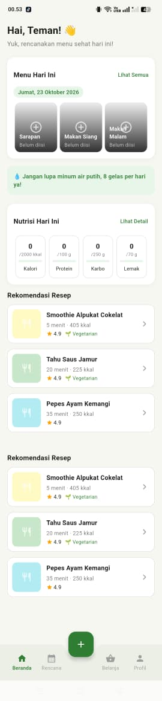
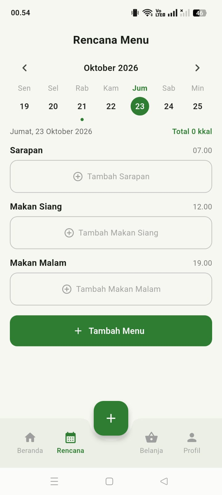
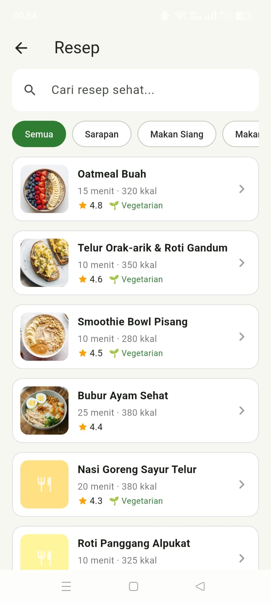
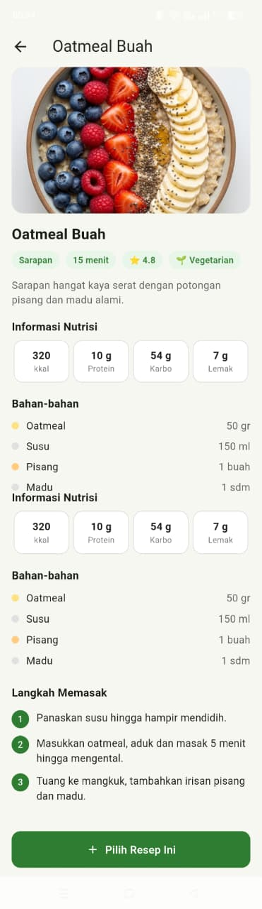
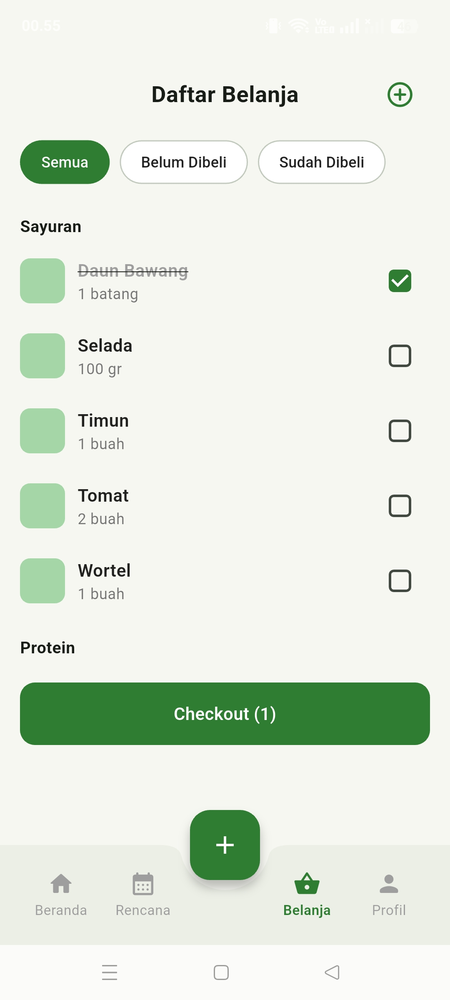
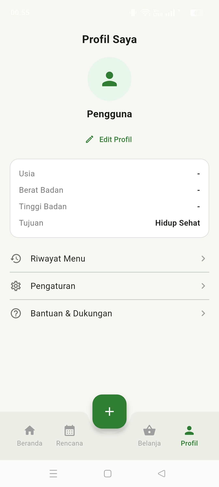

# FoodPlan

FoodPlan adalah aplikasi mobile perencana menu sehat berbasis **Flutter**. Aplikasi ini membantu pengguna menyusun menu harian dan mingguan, memantau nutrisi harian, serta mendapatkan daftar belanja otomatis berdasarkan menu yang direncanakan.

Proyek ini dikembangkan untuk memenuhi tugas UTS mata kuliah **Mobile Programming**.

## Identitas Pengembang

- **Nama:** Asti Sela
- **NPM:** 2413025067
- **Kelas:** PTI24A
- **Dosen Pengampu:** Ghea Chandra Surawan, M.Pd
- **Program Studi:** Pendidikan Teknologi Informasi
- **Fakultas:** FKIP
- **Universitas:** Universitas Lampung

## Masalah yang Diselesaikan

Orang yang memiliki kesibukan sering mengalami kesulitan dalam mengatur pola makan, mengetahui kandungan nutrisi makanan, dan merencanakan pembelian bahan makanan sehingga berpotensi menimbulkan pemborosan.

FoodPlan hadir untuk menggabungkan perencanaan menu, informasi nutrisi, dan pengelolaan daftar belanja otomatis dalam satu aplikasi.

**Target pengguna:** masyarakat umum, mahasiswa, pekerja yang sibuk, serta keluarga atau ibu rumah tangga.

## Fitur Aplikasi

- **Beranda:** menampilkan sapaan, Menu Hari Ini, progres nutrisi harian (kalori, protein, karbohidrat, dan lemak), serta rekomendasi resep.
- **Rencana Menu:** menyediakan kalender mingguan yang dapat berpindah minggu, pengaturan menu berdasarkan waktu makan (sarapan, makan siang, dan makan malam), total kalori harian, serta fitur menghapus menu dengan opsi pembatalan.
- **Resep:** menyediakan 12 resep lengkap dengan foto, pencarian resep, filter kategori, filter vegetarian, serta halaman detail yang berisi informasi nutrisi, bahan, dan langkah memasak.
- **Daftar Belanja Otomatis:** mengumpulkan bahan dari rencana menu, menjumlahkan bahan yang sama, mengelompokkan bahan berdasarkan kategori, mencentang barang yang sudah dibeli, menambahkan barang secara manual, dan melakukan checkout.
- **Detail Nutrisi:** menampilkan progres nutrisi hari ini dan grafik batang kalori selama satu minggu.
- **Profil:** menyediakan pengelolaan data diri dengan validasi, riwayat menu, dan bantuan berupa FAQ.
- **Pengaturan:** menyediakan pengaturan target nutrisi, filter resep vegetarian, dan fitur menghapus seluruh rencana menu.

## Penyimpanan Data

Data aplikasi disimpan secara lokal pada perangkat menggunakan `shared_preferences`.

## Teknologi yang Digunakan

- **Flutter:** framework pengembangan aplikasi mobile.
- **Dart:** bahasa pemrograman.
- **SharedPreferences:** penyimpanan data lokal.

## Cara Menjalankan Aplikasi

### Persyaratan

- Flutter SDK
- Android Studio atau Visual Studio Code
- Emulator Android atau perangkat Android

### Langkah Instalasi

1. Clone repositori atau unduh source code proyek.
2. Buka terminal pada folder proyek FoodPlan.
3. Jalankan perintah berikut untuk mengunduh dependensi:

   flutter pub get

4. Jalankan aplikasi menggunakan perintah:

   flutter run

## Tangkapan Layar

### 1. Beranda

### 2. Rencana Menu

### 3. Resep

### 4. Detail Resep

### 5. Daftar Belanja

### 6. Profil
